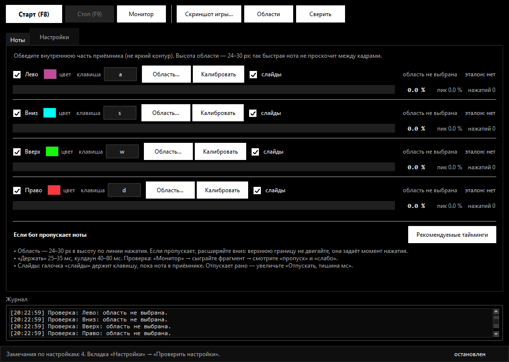
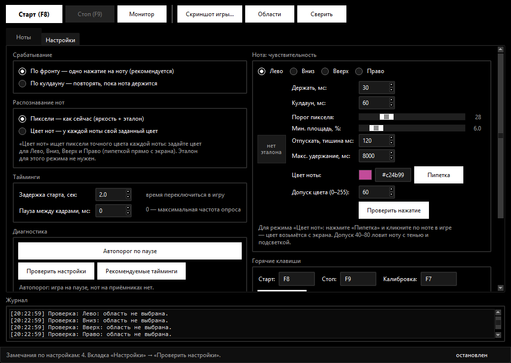

# Fnf-bot


[**Скачать Fnf-bot.exe**](https://github.com/Dezigwer/Fnf-bot/releases/latest)
· Windows, Python не нужен

Оверлейный бот-плеер для FNF (включая Roblox-версии). **В игру ничего не внедряется**:
программа смотрит на экран, замечает, когда в заданной области меняются пиксели,
и нажимает назначенную вами клавишу.

Вы сами указываете боту **где нота** (обводите её на скриншоте игры) и **чем бить**
(назначаете клавишу для каждой из четырёх стрелок).

Есть два способа распознавания — переключаются одной радиокнопкой в настройках:

| Режим | Что сравнивает | Когда нужен |
|---|---|---|
| **Пиксели** | яркость (серое) с эталоном | обычные карты, ноты не меняют цвет |
| **Цвет нот** | точный цвет каждой из 4 нот | у каждой ноты свой цвет, фон другой |

---

## Быстрый старт

1. Запустите **`Fnf-bot.exe`** двойным кликом. Python и установка не нужны.
2. Запустите игру в **оконном или безрамочном** режиме на основном мониторе.
3. Поставьте игру на паузу так, чтобы приёмники были видны, а нот на них не было.
4. В боте нажмите **«Скриншот игры…»** → **«Сделать скриншот (3с)»** (окна бота спрячутся)
   или **«Открыть скриншот…»** и выберите готовый PNG/JPG.
5. На скриншоте обведите **центр приёмника** для каждой ноты и назначьте клавишу,
   затем нажмите **«Применить разметку»**.
6. Закройте редактор. Кнопкой **«Области»** проверьте, что рамки лежат на приёмниках.
7. Нажмите **«Старт»** (или **F8**) и переключитесь в игру.

> Windows SmartScreen может показать «Windows защитила ваш компьютер», потому что
> файл новый и без цифровой подписи. Это нормально для самосборных программ:
> «Подробнее» → «Выполнить в любом случае». Антивирус может ругаться на эмуляцию
> клавиш — добавьте exe в исключения, если доверяете файлу.

`config.json`, папка `shots/` и логи создаются **рядом с exe**. Сам exe можно
переносить куда угодно — главное, чтобы рядом лежали ваши настройки, если хотите
их сохранить.

---

## Как настроить по скриншоту

1. **«Скриншот игры…»**. Если снимаете экран — бот спрячет свои окна на 3 секунды.
2. В редакторе справа выберите ноту: **Лево / Вниз / Вверх / Право**.
3. Обведите мышью область **внутри приёмника**, там где появляется нота.
4. Кликните по полю клавиши и нажмите нужную кнопку. Раскладка не важна:
   бот запоминает физическую клавишу, а не русскую/английскую букву.
5. Повторите для всех четырёх нот и нажмите **«Применить разметку»**.
   Эталон («спокойный» вид области) возьмётся прямо из скриншота — отдельная
   калибровка не нужна.
6. Если скриншот не на весь экран — **«Привязать к экрану…»**, обведите место,
   где картинка находится на экране. Координаты пересчитаются.
7. **«Показать на экране»** — рамки поверх игры. Они должны совпасть с приёмниками.
8. **«Сверить»** — бот сравнит текущий экран с эталоном. Проценты должны быть
   около нуля (если сейчас не идёт песня).

### Главное правило области

Обводите **рабочую линию приёмника**, а не яркий контур и не узкую полосу у нижнего края.

* Высота области — **24–30 px**. Полоса 8–12 px слишком тонкая: быстрая нота
  проскакивает между кадрами, и бот её не видит.
* Ширина — примерно по ширине приёмника (60–100 px).
* Внутри области не должно быть меняющегося фона и анимации.

**Главный приём.** Верхняя граница области задаёт момент нажатия: нота входит в
неё — бот жмёт. Поэтому при пропусках **расширяйте область вниз**, не двигая
верхнюю границу: нажатие останется в тот же момент, но нота будет дольше
оставаться в кадре. Если сдвинуть область вверх, бот начнёт жать раньше; если
вниз — позже. Внешне и то и другое выглядит как «иногда пропускает».

---

## Интерфейс

### Вкладка «Ноты»



* галочка — нота включена;
* поле клавиши — нажмите на него и введите нужную кнопку;
* **«Область…»** — обвести область прямо на экране;
* **«Калибровать»** — снять эталон с экрана (игра на паузе);
* галочка **«слайды»** — держать клавишу, пока через приёмник идёт длинная нота;
* полоса и проценты — насколько текущий кадр отличается от эталона;
* справа: координаты/размер области, состояние эталона, «пик», число нажатий,
  **«пропуск»** (нота пришла во время кулдауна) и **«слабо»** (изменение было,
  но ниже порога).

Внизу вкладки — короткая памятка и кнопка **«Рекомендуемые тайминги»**.

### Вкладка «Настройки»



* **Срабатывание**:
  * *По фронту* — одно нажатие на ноту (рекомендуется);
  * *По кулдауну* — повторять, пока нота держится.
* **Распознавание нот**:
  * *Пиксели* — сравнение яркости с эталоном;
  * *Цвет нот* — у каждой ноты свой точный цвет, бот ищет пиксели этого цвета.
* **Тайминги**: задержка старта (время переключиться в игру) и пауза между кадрами
  (0 = максимальная частота опроса).
* **Диагностика**:
  * **«Автопорог по паузе»** — 1,5 секунды измеряет шум в областях и ставит порог
    чуть выше него. Игра должна стоять на паузе, нот на приёмниках быть не должно.
  * **«Проверить настройки»** — ищет тонкие области, слишком короткое «держать»,
    большой кулдаун, пустой эталон, отсутствие клавиши.
  * **«Рекомендуемые тайминги»** — ставит «держать» 30 мс, кулдаун 60 мс,
    паузу между кадрами 0.
* **Нота: чувствительность** — «держать», кулдаун, порог пикселя и минимальная
  площадь для выбранной ноты, **цвет ноты** и **допуск цвета** для цветного режима,
  «Отпускать, тишина мс» и «Макс. удержание, мс» для слайдов, плюс превью эталона.
* **Горячие клавиши** — по умолчанию F8 / F9 / F7, можно поменять.
* **Прочее** — открыть папку, сбросить эталоны или статистику.

### Режим «Монитор»

Бот ничего не нажимает, только показывает проценты и статистику. Это лучший способ
понять, почему пропускаются ноты:

* проценты почти не поднимаются — область стоит мимо ноты;
* поднимаются до 3–5 %, но не до порога — порог завышен (или область слишком большая);
* «слабо» растёт — порог площади/пикселя слишком высокий;
* «пропуск» растёт — кулдаун слишком большой или «держать» слишком короткое.

---

## Почему бот пропускает ноты

Чаще всего дело не в пороге, а в геометрии области. Вот реальный пример настроек,
с которыми бот стабильно терял быстрые ноты:

| Нота | Было | Стало (та же верхняя граница) |
|---|---|---|
| Лево | `612, 1016, 93×8` | `612, 1016, 93×24` |
| Вниз | `822, 1020, 78×9` | `822, 1020, 78×24` |
| Вверх | `1017, 1017, 88×12` | `1017, 1017, 88×28` |
| Право | `1226, 1017, 79×8` | `1226, 1017, 79×24` |

Причины пропусков:

1. **Области 8–12 px в высоту.** Нота пролетает такую полосу за один-два кадра.
2. **«Держать» = 1 мс** — многие игры не успевают увидеть такое короткое нажатие.
   Ставьте **25–35 мс**.
3. **Кулдаун = 0** — при дрожании картинки возможны лишние нажатия, а при
   «по фронту» — пропуски следующей ноты. Ставьте **40–80 мс**.
4. **Эталон полностью чёрный** — для чёрного приёмника в Roblox-FNF это нормально:
   нота появляется поверх чёрного фона. Проверять нужно не «черноту», а всплеск
   процентов в «Мониторе», когда нота проходит через область.

Что сделать: откройте скриншот в редакторе и **растяните каждую область вниз** до
24–30 px по высоте (ориентиры — в таблице выше). Верхнюю границу оставьте на месте:
именно она задаёт момент нажатия, и вы его уже подобрали. Затем нажмите
**«Применить разметку»** и проверьте «Монитор»: на ноте проценты должны уверенно
превышать порог, а «пропуск» и «слабо» — не расти.

После увеличения высоты площадь области выросла в 2–3 раза, поэтому **проценты
изменения стали меньше**. Если в «Мониторе» растёт «слабо», уменьшите «Мин. площадь»
до 2–4 % (или нажмите «Автопорог по паузе» при пустых приёмниках).

Если бот жмёт **слишком рано** — сдвиньте верхнюю границу на 5–10 px вниз;
если поздно — вверх. Высоту при этом не меняйте.

---

## Как это работает

```
экран → mss-захват областей (≈150–250 кадров/с)
      → grayscale или RGB + сравнение с эталоном
      → % изменившихся пикселей
      → если % ≥ порога → SendInput (scan code)
```

* **Порог пикселя** (1–120) — насколько пиксель должен отличаться от эталона.
  Меньше = чувствительнее.
* **Мин. площадь, %** — какая доля области должна измениться. Главный фильтр
  от ложных срабатываний.
* **Держать, мс** — длительность нажатия.
* **Кулдаун, мс** — минимальный интервал между нажатиями одной ноты.

Нажатия отправляются **scan-кодами** через `SendInput`, поэтому их видят игры,
читающие DirectInput/Raw Input (в том числе Roblox).

### Режимы срабатывания

* **По фронту** (по умолчанию) — одно нажатие на появление ноты. Пока изменение
  держится, повторных нажатий нет; после того как область успокоилась и кулдаун
  прошёл, бот снова готов.
* **По кулдауну** — нажимает повторно, пока изменение держится. Нужно, если в игре
  нота «залипает» или приёмник подсвечен постоянно.

### Режимы распознавания

**Пиксели** — как было с самого начала: кадр переводится в оттенки серого и
сравнивается с серым эталоном. Режим точный и быстрый, но у него есть слабое место:
если нота по яркости совпала с фоном, бот её не увидит. В радужных картах это
случается регулярно — зелёная нота на сером фоне даёт такую же яркость, как пустой
приёмник.

**Цвет нот** — вы задаёте **точный цвет каждой из четырёх нот** (Лево, Вниз,
Вверх, Право), и бот ищет в области приёмника пиксели именно этого цвета. Фон и
обводка приёмника в цвет ноты не попадают, а сама нота даёт резкий скачок.

Цвет удобнее всего взять пипеткой прямо с экрана: вкладка **«Нота:
чувствительность»** → **«Пипетка»** → клик по ноте в игре. Или вписать HEX
(`#c24b99`) вручную, или открыть системный выбор цвета кликом по образцу.

По умолчанию стоят стандартные цвета FNF:

| Нота | Цвет |
|---|---|
| Лево | `#c24b99` (фиолетовый) |
| Вниз | `#00ffff` (голубой) |
| Вверх | `#12fa05` (зелёный) |
| Право | `#f9393f` (красный) |

Практические мелочи:

* **«Допуск цвета»** по умолчанию **60**; рабочий диапазон — **40–80**. Это
  евклидово расстояние в RGB: чем больше, тем шире «вилка» вокруг цвета ноты
  (тень, подсветка, сжатие видео). Слишком большой — бот начнёт путать ноты и фон,
  слишком маленький — будет пропускать ноту с тенью.
* Эталон для этого режима **не нужен**: ни «Калибровать», ни скриншот не требуются.
  Переключились на «Цвет нот», задали 4 цвета — и всё.
* Цвета нот можно менять и во вкладке нот: у каждой строки есть образец цвета,
  клик по нему открывает выбор цвета.
* Если в вашей игре ноты переливаются радугой, а не имеют постоянного цвета,
  цветовой режим не подойдёт — берите «Пиксели» либо задайте самый частый оттенок.
* Если приёмник сам по себе содержит пиксели цвета ноты (подсветка, узор фона),
  поднимите «Мин. площадь» или обведите область внутри приёмника, где фон ровный.
* Режим «цвет нот» видит и хвост слайдера — если хвост того же цвета, слайды
  работают так же, как в пиксельном.


---

## Слайды (длинные ноты)

У каждой ноты есть галочка **«слайды»** — бот держит клавишу, пока нота (или хвост
слайдера) видна в приёмнике, и отпускает, когда она ушла.

Как это устроено:

```
нота пришла в приёмник → key_down
        ↓
в приёмнике видна нота/хвост → держим
        ↓
приёмник опустел и молчит 120 мс → key_up
```

* Отдельную зону размечать не нужно: сигнал берётся из той же области приёмника,
  которую вы уже обвели.
* Если нота исчезла почти сразу (короткая, тап) — клавиша отпускается через
  «Держать», как раньше.
* Хвост слайдера тоньше головы ноты и может не добирать «Мин. площадь». Поэтому,
  пока клавиша уже зажата, бот использует пониженный порог (35 % от «Мин.
  площади») — слайд не обрывается на середине и не тапается как обычная нота.
* **«Отпускать, тишина мс»** — сколько приёмник должен молчать, чтобы бот решил,
  что слайдер кончился. Мало — отпустит раньше времени, много — задержит.
* **«Макс. удержание, мс»** — страховка от залипания: если в области остался шум,
  бот всё равно отпустит клавишу через это время и напишет в журнал
  «слайд держался слишком долго».
* Если нота пришла, пока клавиша ещё зажата, бот сначала отпускает её и жмёт
  заново — иначе игра не засчитала бы новое нажатие.

Если слайды не нужны — снимите галочку: нота будет нажиматься коротко, как раньше.

### Двойные ноты (аккорды)

Если две стрелки приходят одновременно, бот нажимает обе клавиши **одним
системным вызовом** — без зазора по времени, чтобы игра увидела их в одном кадре.
В журнале появляется строка «Двойное нажатие: Вниз + Право».

Если аккорды всё равно иногда пропускаются:

* уменьшите «Кулдаун» до 40 мс — при плотном потоке бот успеет перевзвестись;
* увеличьте «Держать» до 40–50 мс, если игра работает на 30 fps: слишком короткое
  нажатие может не попасть между её кадрами;
* проверьте, что у обеих нот стоят галочки и клавиши не совпадают.

### Если слайд отпускается раньше времени

Приёмник может «мигать», если хвост тонкий или полупрозрачный. Увеличьте
«Отпускать, тишина мс» (например до 120–150) — бот будет пережидать короткие
провалы. Если наоборот задерживает — уменьшите до 50–60.

### Если бот вообще перестал нажимать

Признак зажатой клавиши: игра видит клавишу нажатой и игнорирует новые нажатия.
Бот теперь отпускает такую клавишу сам (см. «Макс. удержание»), но для проверки
можно снять галочки «слайды» на всех нотах и запустить снова — короткие ноты
должны играться как раньше.

---

## Оформление

* Фон окна — **сплошной чёрный**, без прозрачности, акрила и размытия: окно нигде
  не просвечивает и не «исчезает» при клике по фону.
* Кнопки — **белые, плоские**, в стиле Windows 11: без объёма, скруглений-градиентов
  и серых вдавленных рамок. Текст на них чёрный.
* Поля ввода, списки и вкладки — тёмно-серые с белым текстом; полосы прокрутки
  тёмные, галочки на белом фоне, акцент — белый.
* Заголовок окна тёмный, углы скруглённые — нативные эффекты Windows 11
  (`fnfbot/wineffects.py`). На старой Windows они просто не применяются.
* Снизу — **плоская тёмная строка состояния** с двумя панелями (сообщение / режим).
* Иконка `logo.png` используется только для exe, панели задач и заголовка окна —
  внутри программы и в меню её нет.

Прозрачность не включается нигде: все окна создаются полностью непрозрачными,
поэтому клик по фону не может «растворить» программу.

---

## Горячие клавиши

| Клавиша | Действие |
|---|---|
| **F8** | старт |
| **F9** | стоп |
| **F7** | калибровка всех нот |

Меняются на вкладке «Настройки». Формат: `F8`, `ctrl+shift+s`. Работают, даже
когда окно бота не в фокусе.

---

## Если что-то не работает

* **Клавиши не нажимаются в игре.** Если игра запущена от администратора, запустите
  бота тоже от администратора. Проверьте, что игра в оконном/безрамочном режиме.
* **Бот нажимает без остановки сразу после старта.** Эталон не совпадает с экраном:
  окно игры стоит иначе или другого размера. «Сверить» → «Калибровать» (игра на паузе)
  или разметьте скриншот заново.
* **Области смещены.** Масштаб Windows ≠ 100 % или скриншот снят в другом разрешении.
  Бот включает DPI-awareness сам; для скриншота не на весь экран используйте
  «Привязать к экрану…».
* **Пропускает быстрые ноты.** Растяните области вниз до 24–30 px (верхнюю границу
  не двигайте), «держать» 25–35 мс, кулдаун 40–80 мс, пауза между кадрами 0.
  Если выросло «слабо» — уменьшите «Мин. площадь» до 2–4 %. Смотрите статистику
  в «Мониторе».
* **Пропускает ноты, которые меняют цвет.** Переключите «Распознавание нот» на
  **«Цвет нот»** и задайте точный цвет каждой ноты (пипеткой с экрана). При
  необходимости подстройте «Допуск цвета» (40–80). Калибровка и эталон этому
  режиму не нужны.
* **Слайд обрывается посередине.** Увеличьте «Отпускать, тишина мс» до 120–150 и
  слегка поднимите «Допуск цвета» / опустите «Мин. площадь»: тонкий хвост должен
  попадать в порог.
* **Окно исчезает при клике по фону.** Такого в этой версии быть не может —
  прозрачность не используется вообще. Если остался старый `Fnf-bot.exe`,
  удалите его и запустите новый.
* **Двойные нажатия.** Увеличьте кулдаун, включите «по фронту», сузьте рамку.
* **Тормозит.** Уменьшите области, поставьте паузу между кадрами 0, закройте лишние
  вкладки браузера.
* **Несколько мониторов.** Бот работает с основным монитором — игру лучше держать на нём.
* **Ошибка при старте.** Смотрите `error.log` рядом с exe.

---

## Самопроверка

```bat
Fnf-bot.exe --selftest
```

Проверяет детектор, конфиг, scan-коды, горячие клавиши, независимость от раскладки,
логику срабатываний, удержание слайдов и распознавание по цвету нот (94 проверки).
Результат пишется в `selftest.log` рядом с exe.

---

## Запуск из исходников и сборка

```bat
run.bat                    :: создать .venv, поставить зависимости, запустить
.venv\Scripts\python main.py --selftest
build_exe.bat              :: собрать один Fnf-bot.exe
```

`build_exe.bat` ставит PyInstaller и собирает onefile-версию с иконкой, после чего
копирует exe в корень проекта. Внутрь упакованы `selftest.py` и иконка.

`config.json`, `shots/` и логи появляются рядом с exe при запуске — в репозиторий
они не попадают.

### Файлы

```
Fnf-bot.exe                готовый бот (один файл, лежит в релизе)
main.py                    точка входа
run.bat                    запуск из исходников
build_exe.bat              сборка exe
selftest.py                самопроверка (94 проверки)
requirements.txt           mss, numpy, Pillow
logo.png                   исходный логотип
hero.gif                   баннер для README
docs/                      скриншоты интерфейса
LICENSE                    MIT
fnfbot/
  config.py                модель настроек и сохранение
  capture.py               захват экрана (mss / PIL)
  detector.py              сравнение с эталоном
  holds.py                 логика удержания слайдов
  keys.py                  SendInput по scan-кодам
  hotkeys.py               глобальные горячие клавиши
  engine.py                поток бота: захват → детект → нажатие
  overlay.py               выделение области и проверка рамок
  screenshot.py            скриншоты, вырезание эталонов
  shot_editor.py           редактор скриншота
  theme.py                 тёмная тема интерфейса
  gui.py                   главное окно
```

---

## Важно

Бот не читает память игры и не изменяет её — это обычная автоматизация ввода
по картинке. Используйте его для себя: в соревновательных и рейтинговых режимах
автоматизация обычно запрещена правилами, и решение об использовании остаётся за вами.


